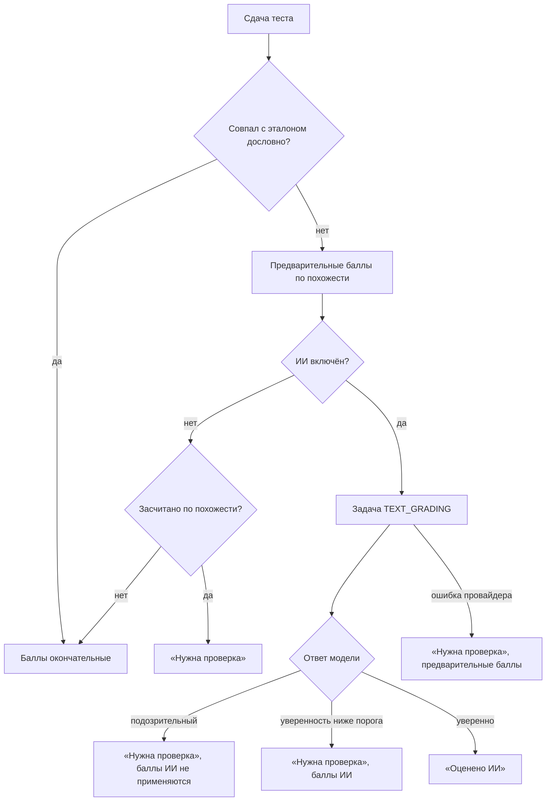

# ИИ: проверка ответов, сканы лекций, презентации

## Что умеет

| Функция | Где | Что делает ИИ | Решение за человеком |
|---|---|---|---|
| Проверка свободных ответов | сдача теста, «Проверка ответов» | оценивает ответ по смыслу, по эталону и критериям | неуверенные и подозрительные оценки проверяет преподаватель |
| Подсказка критериев | редактор вопроса | предлагает 2–5 пунктов полного ответа с баллами | преподаватель правит и сохраняет |
| Скан печатной лекции | редактор лекции (веб и телефон) | распознаёт страницы и размечает текст в Markdown | преподаватель вычитывает и вставляет в текст лекции |
| Презентация по лекции | веб: «Лекции» → «Презентация» | составляет план слайдов, генерирует картинки | преподаватель правит план и собирает PPTX/PDF |

## Провайдеры

Один параметр `APP_AI_PROVIDER`:

| Значение | Что это | Тексты | Распознавание | Картинки |
|---|---|---|---|---|
| `none` | ИИ выключен (по умолчанию) | — | tesseract, если установлен | — |
| `yandex` | Yandex AI Studio | да | Yandex Vision OCR | да |
| `gigachat` | GigaChat API | да | tesseract | — |
| `openai` | любой OpenAI-совместимый API: Ollama, DeepSeek, прокси | да | tesseract | если API умеет `/images/generations` |

Все тексты идут через Chat Completions в формате OpenAI (`OpenAiCompatibleChatClient`), поэтому провайдер меняется настройкой, без кода. У Yandex имена моделей превращаются в URI `gpt://<каталог>/<модель>`, ключ передаётся как `Api-Key`, добавляются заголовки каталога и `x-data-logging-enabled: false` (провайдер не сохраняет запросы для обучения). GigaChat получает токен по ключу авторизации (`GigaChatTokenProvider`); его сертификаты выданы «Russian Trusted Root CA» — сертификат нужно добавить в truststore JVM.

Ключ API хранится только на сервере и в клиенты не попадает.

### Пример: Yandex AI Studio

```env
APP_AI_PROVIDER=yandex
APP_AI_API_KEY=<API-ключ сервисного аккаунта>
APP_AI_FOLDER_ID=<идентификатор каталога>
```

Модели по умолчанию: `aliceai-llm-flash` — проверка ответов и разметка сканов, `aliceai-llm` — план презентации, `aliceai-image-art-3.0` — картинки.

### Пример: Groq (используется сейчас)

```env
APP_AI_PROVIDER=openai
APP_AI_BASE_URL=https://api.groq.com/openai/v1
APP_AI_API_KEY=<ключ Groq>
APP_AI_MODEL_GRADING=qwen/qwen3.8-27b
APP_AI_MODEL_LECTURE=qwen/qwen3.8-27b
APP_AI_MODEL_PRESENTATION=openai/gpt-oss-120b
APP_AI_IMAGE_GENERATION_ENABLED=false
APP_AI_PRESENTATION_MAX_SOURCE_CHARS=20000
```

Бесплатный тариф Groq ограничивает каждую модель 8000 токенами в минуту (≈ 4 символа русского текста на токен), поэтому текст для плана презентации урезается до 20 000 символов. Выгрузки DOCX/PDF текста самой лекции и собственные презентации в источник не попадают — это тот же текст. Отказы провайдера, которые повтором не исправить (401/403 ключ, 404 модель, 413 слишком большой запрос), завершают задачу сразу; 429 и 5xx повторяются с паузой.

Проверка ответа и подсказка критериев — меньше секунды, план презентации — 5–10 с; распознавание — Tesseract на сервере. Модели-«рассуждатели» присылают ход мысли в `<think>…</think>` — клиент его отбрасывает. Ключ хранится только в `.env` (он в `.gitignore`).

### Пример: Ollama на компьютере с Docker

```env
APP_AI_PROVIDER=openai
APP_AI_BASE_URL=http://host.docker.internal:11434/v1
APP_AI_MODEL_GRADING=qwen2.5:7b
APP_AI_MODEL_LECTURE=qwen2.5:7b
APP_AI_MODEL_PRESENTATION=qwen2.5:7b
APP_AI_IMAGE_GENERATION_ENABLED=false
```

## Фоновые задачи

Долгие операции выполняются в фоне. Задачи хранятся в таблице `AiJobs` (тип, статус, вход, результат, ошибка, расход), поэтому переживают перезапуск сервера. `AiJobWorker` опрашивает таблицу и забирает задачу атомарным `UPDATE … WHERE Status = 1`: каждую задачу выполняет ровно один исполнитель, даже если серверов несколько. Задачи, прерванные остановкой сервера, при старте возвращаются в очередь. Ошибки провайдера повторяются с паузой (30 с × номер попытки); ошибки во входных данных не повторяются.

| Тип | Цель | Результат |
|---|---|---|
| `TEXT_GRADING` | ответ студента | оценка в `QuestionResponses` |
| `CRITERIA_SUGGESTION` | — | синхронный вызов, записан для учёта расхода |
| `LECTURE_SCAN` | лекция (необязательно) | `{markdown, pages, ocrEngine}` |
| `PRESENTATION_OUTLINE` | лекция | план слайдов |
| `PRESENTATION_BUILD` | лекция | `{materialId, pdfMaterialId, slides}` |
| `IMAGE_GENERATION` | лекция | путь к картинке в `APP_AI_STORAGE_DIR` |

Клиенты опрашивают `GET /api/v1/ai/jobs/{id}`; там же текст хода выполнения («Распознаю страницу 3 из 10»).

## Расход и лимит

Каждая задача хранит входные и выходные токены, страницы распознавания и картинки. `APP_AI_MONTHLY_TOKEN_LIMIT` ограничивает токены за календарный месяц (0 — без лимита). `GET /api/v1/ai/status` сообщает только, какие функции включены, — расход преподавателям и студентам не показывается.

Отчёт о расходе — `GET /api/v1/admin/ai-usage?from=YYYY-MM-DD&to=YYYY-MM-DD` (по умолчанию текущий месяц; `AiUsageReportService`), в вебе — «Система → Расход ИИ». Доступ — роль ADMIN или право `ai.usage.read` (так его можно выдать модератору в «Роли и права»). В отчёте: итоги за период, расход месяца и лимит, разбивка по типам задач, по преподавателям и по студенческим группам. Проверка ответа относится к автору теста (тесты без автора — в строку «Без автора») и к группам студента; остальные задачи — к тому, кто их запустил.

## Проверка свободных ответов



Модель получает вопрос, эталонные ответы, критерии (`TestQuestions.GradingCriteria`) и ответ студента; все они помечены как данные, а не инструкции. Ответ — JSON: доля баллов, вердикт, уверенность, засчитанные и пропущенные пункты, комментарий студенту, признак попытки повлиять на проверку. Порог уверенности — `APP_AI_GRADING_REVIEW_THRESHOLD` (0,7).

Состояние ответа (`QuestionResponses.ReviewStatus`): `0` — проверка не нужна, `1` — проверяет ИИ, `2` — нужна проверка преподавателя, `3` — оценено ИИ, `4` — проверено преподавателем. Источник баллов — `GradedBy`: правила, ИИ или преподаватель. После каждой поздней оценки итоговый балл попытки пересчитывается (`AttemptScoreService`).

Комментарий ИИ студенту показывается, если в тесте включено «Показывать студентам комментарий ИИ» (`Tests.ShowAiFeedback`). Правильный ответ студенту по-прежнему не раскрывается.

### Очередь «Проверка ответов»

`GET /api/v1/results/teacher/review?status=needs_teacher|ai_pending|ai_graded|teacher_confirmed|all` — ответы по тестам преподавателя (его тесты и тесты, привязанные к его лекциям; администратор видит все).

| Действие | Запрос |
|---|---|
| Поставить баллы и комментарий | `PUT /api/v1/results/teacher/responses/{id}/grade` |
| Подтвердить оценку как есть | `POST /api/v1/results/teacher/responses/{id}/accept` |
| Перепроверить ИИ (например, после правки критериев) | `POST /api/v1/results/teacher/responses/{id}/ai-regrade` |

## Скан лекции

Принимаются JPEG, PNG и PDF (до 40 файлов, PDF до 60 страниц). У страниц PDF с текстовым слоем текст берётся напрямую, остальные рендерятся в 200 dpi и распознаются. Фото уменьшаются до 2480 px по длинной стороне. Распознавание:

- **Yandex Vision OCR** — для провайдера `yandex` (около 0,13 ₽ за страницу печатного текста);
- **Tesseract** — бесплатно на сервере; в Docker-образ бэкенда входят `tesseract-ocr` и русский язык.

Исходные сканы прикрепляются к материалам при **сохранении лекции**: после «Заменить»/«Добавить в конец» они попадают в список файлов, ждущих сохранения (веб и мобилка). Параметр API `attachOriginals=true` (прикрепить сразу) оставлен для совместимости.

Затем модель склеивает строки, убирает колонтитулы и размечает заголовки, списки и таблицы — частями по 7000 символов. Результат — черновик; текст лекции хранится в `CourseLectures.Body` (Markdown) и показывается студенту на странице лекции (веб и телефон, с озвучиванием).

На телефоне страницы снимаются системным сканером документов (Android: ML Kit Document Scanner — обрезка, выравнивание, несколько страниц), камерой или выбираются из файлов.

## Выгрузка текста лекции в Word и PDF

Текст лекции (Markdown) выгружается в DOCX (Apache POI) и PDF (PDFBox, встроенные шрифты DejaVu — кириллица одинакова на любом устройстве): заголовки, списки, цитаты, код, таблицы, ссылки. Заголовки DOCX получают уровень структуры — видны в области навигации Word и попадают в оглавление.

| Действие | Запрос |
|---|---|
| Скачать (преподаватель) | `GET /api/v1/lectures/{id}/text/export?format=docx\|pdf` |
| Сохранить в материалы лекции | `POST /api/v1/lectures/{id}/text/materials?format=docx\|pdf` |
| Скачать (студент) | `GET /api/v1/public/learning/lectures/{id}/text/export?format=docx\|pdf` |

Код: `service/lecture/MarkdownDocument` (разбор, совпадает с вебом и мобилкой), `LectureTextExporter`, `LectureTextExportService`.

## Презентация

1. **План** (`PRESENTATION_OUTLINE`): текст лекции, описание и текст материалов (PDF, DOCX, PPTX, TXT, MD; до 60 000 символов) → слайды: вид (тезисы, две колонки, шаги процесса, титул раздела, цитата), заголовок, пункты, заметки докладчика, пожелание к картинке.
2. **Картинки**: найти в Wikimedia Commons и Openverse (свободные лицензии; автор и лицензия попадают в заметки слайда), сгенерировать ИИ или взять картинку из материалов лекции. Схемы ИИ рисует не картинкой, а слайдом «шаги процесса» — так они точные.
3. **Сборка** (`PRESENTATION_BUILD`): PPTX 16:9 в цветах темы «Политех» (Apache POI) и PDF-копия (рендер слайдов, PDFBox). Файлы сохраняются в материалы лекции.

Поиск картинок (`ImageSearchService`): Wikimedia Commons — основной банк (ждём до 6 с), Openverse — дополнительный: после ответа Wikimedia ему даётся 2,5 с (если Wikimedia ничего не нашёл — до 8 с). Не ответивший Openverse пропускается 5 минут, полные ответы кэшируются на 15 минут. Не ответившие банки перечисляются в заголовке ответа `X-Image-Sources-Unavailable` — мастер пишет «… сейчас не отвечает», а не «ничего не найдено».

Картинки из банков скачивает сервер, только по https и только с `upload.wikimedia.org`, `thumb.wikimedia.org` и `api.openverse.org` (`RemoteImageFetcher`) — через него нельзя обратиться к произвольному адресу. Превью в вебе тоже идут через сервер: CSP фронта разрешает только свои картинки.

## Где в коде

- `service/ai/` — провайдеры, очередь, обработчики задач;
- `service/ResponseReviewService`, `web/controller/rest/ReviewRestController` — очередь проверки;
- `web/controller/rest/AiRestController` — `/api/v1/ai/**` (только преподаватель и администратор);
- фронт: `api/ai.api.js`, `composables/ai/`, `views/results/ReviewQueueView.vue`, `components/teacher/LectureBodyEditor.vue`, `views/teacher/LecturePresentationView.vue`, `components/lectures/LectureMarkdown.vue`;
- мобилка: `domain/AiFeatures.kt`, `domain/Markdown.kt`, `feature/teacher/ReviewScreen.kt`, `core/platform/DocumentScanner*.kt`.
