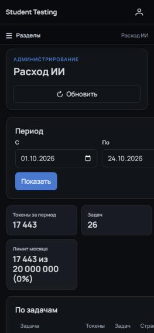

# Отчёт о проверке ИИ-функций — 24.10.2026

Ручная проверка по [тест-кейсам ИИ](./ai-test-cases.md). Ветка `master` `73a3d9d` (слит PR #6 «ИИ»), ИИ — Groq с моделями из README.

Пройдено 68 кейсов: через API бэкенда, в веб-версии и в Android-приложении на эмуляторе.

| Итог | Кейсов |
|---|---|
| ✅ прошли | 60 |
| 🟡 частично | 3 |
| ❌ не прошли | 3 |
| ⚪ не проверялись | 2 |

## Ошибки

### Поиск картинок для презентации почти всегда пустой (кейс 5.3)

Wikimedia сейчас отдаёт уменьшенные картинки с адреса `thumb.wikimedia.org`, а `RemoteImageFetcher.ALLOWED_HOSTS` пропускает только `upload.wikimedia.org` и `api.openverse.org`. Все результаты Wikimedia отбрасываются молча. Остаётся Openverse, который отвечает медленно и иногда не укладывается в `SOURCE_TIMEOUT_SECONDS = 9` — тогда список пустой.

Мастер при этом пишет «Ничего не найдено — попробуйте другие слова, лучше по-английски.», хотя по запросу «computer keyboard» у Wikimedia есть картинки. Тот же запрос к Wikimedia из контейнера бэкенда отвечает за 0,5–1 с и возвращает URL на `thumb.wikimedia.org`.

**Что поправить:** добавить `thumb.wikimedia.org` в разрешённые адреса (и для поиска, и для загрузки картинки при сборке); когда источник не ответил, писать об этом, а не «ничего не найдено».

### «Расход ИИ» не помещается на экране 375 px (кейс 6.6)

На ширине 375 px карточки растягиваются до ~540 px, ширина страницы становится 550–577 px, появляется горизонтальная прокрутка; правые колонки таблиц и поле «По» обрезаны. У обёрток таблиц есть `overflow-x: auto`, но карточки растягиваются по таблицам — похоже, контейнеру не хватает `min-width: 0`. Профиль на той же ширине помещается ровно в 375 px.

### В вебе нет «Прочитать вслух» у текста лекции (кейс 3.8)

Кейс рассчитан на веб и мобилку. В мобилке кнопка есть у шапки лекции и у текста. В вебе на странице лекции студента её нет, а в коде фронтенда озвучивание не найдено вовсе (ни «Прочитать вслух», ни `speechSynthesis`). Либо добавить в веб, либо убрать «В» из кейса.

## Замечания

- **Неверный ключ ИИ повторяется как временная ошибка** (кейс 7.1). Ответ 401 «ключ отклонён» обрабатывается как сбой сети: 3 попытки с паузами 30 и 60 с. Студент около полутора минут видит «Проверяет ИИ», и только потом ответ уходит преподавателю. Для 401/403 от провайдера можно завершать задачу сразу.
- **Очередь проверки не обновляется после «Перепроверить ИИ»** (кейс 2.10). Новая оценка готова через 1,5 с, но в вебе счётчики и карточка не меняются и через 18 с — видно только после кнопки «Обновить».
- **Ответ на чужую лекцию — 400 по-английски** (кейс 4.9). Студент получает 400 «Lecture is not assigned to current student: 2». Кейс ожидает 403 или 404; сообщение стоит перевести.
- **Мобилка прикрепляет скан к материалам без сохранения лекции** (кейс 3.4, 3.7). В мобильном редакторе галочка «Прикрепить сканы к материалам лекции» включена по умолчанию, и файл прикрепляется сразу при распознавании. Я распознал страницу и закрыл редактор без сохранения — page41.png всё равно остался в материалах.
- **Совет «удалите вопросы» нельзя выполнить** (кейс 5а.3). Сообщение об отказе в удалении лекции советует удалить вопросы, но удаления вопросов нет ни в API, ни в интерфейсе — только скрытие и перенос в другую тему.

## Документация и окружение

- **Формулировка кейса 5а.5.** Сервер считает только попытки, сделанные через назначение теста на саму лекцию. Если тест привязан к лекции, а проходился через назначение группе, лекция удаляется (тест и попытки сохраняются). Кейс «студент проходил тест, привязанный к лекции» стоит уточнить.
- **Автотесты фронтенда на Windows.** Lint, статические проверки, 788 тестов и сборка проходят на копии с LF. В выкачке на Windows (core.autocrlf=true) падают 5 тестов, сравнивающих исходники как текст с `\n`. Поможет строка в .gitattributes с eol=lf для .js и .vue, как уже сделано для Kotlin.
- **Распознавание латиницы.** Tesseract с русским словарём прочитал «HDD» как «НОО». Для учебных текстов с терминами стоит проверить связку rus+eng.

## Результаты по разделам

В — веб, М — Android-приложение, API — запросы к бэкенду, Docker — перезапуск бэкенда с другой настройкой.

### 1. Критерии оценивания

| № | Итог | Как | Что увидел |
|---|---|---|---|
| 1.1 | ✅ прошёл | В, API | Критерии появляются за 1–3 с в виде «— … — 1 б.», сумма равна баллу вопроса. |
| 1.2 | ✅ прошёл | В, API | В вебе кнопка неактивна с подсказкой «Сначала заполните вопрос и правильный ответ.», API отвечает 400 «Сначала укажите эталонный ответ.». Поле не меняется. |
| 1.3 | ✅ прошёл | М | Критерии подставляются в мобильном редакторе. |
| 1.4 | ✅ прошёл | В | При APP_AI_PROVIDER=none кнопки нет, поле критериев для ручного ввода остаётся. |

### 2. Автопроверка свободных ответов

| № | Итог | Как | Что увидел |
|---|---|---|---|
| 2.1 | ✅ прошёл | API | Дословный эталон засчитан сразу, задача ИИ не создаётся. |
| 2.2 | ✅ прошёл | API | Сразу после сдачи — на проверке у ИИ, через ~3 с полный балл. Автообновление страницы студента в браузере не смотрел. |
| 2.3 | ✅ прошёл | API | «Монитор» как устройство ввода — 0 б., статус «Оценено ИИ», понятный комментарий. |
| 2.4 | ✅ прошёл | API, В | Две инъекции (рус./англ.) — 0 б., «Нужна проверка», в вебе пометка «Похоже на попытку обмануть ИИ». |
| 2.5 | ✅ прошёл | API | Опция включена — комментарий ИИ отдаётся студенту, выключена — нет. |
| 2.6 | ✅ прошёл | API, Docker | Задачи, зависшие при недоступном ИИ, пережили остановку бэкенда и после запуска выполнены повторно. |
| 2.7 | ✅ прошёл | В, М | Вкладки со счётчиками; на карточке вопрос, ответ, эталон, критерии, оценка и уверенность ИИ. |
| 2.8 | ✅ прошёл | API | Свои баллы и комментарий → «Проверено»; итог у студента пересчитан (2+1+2), комментарий виден. |
| 2.9 | ✅ прошёл | API | «Подтвердить как есть» → «Проверено», баллы прежние. |
| 2.10 | ✅ прошёл | API, В, М | После смены критериев ответ уходит на проверку и получает новую оценку. В вебе страница сама не обновляется — см. замечание. |
| 2.11 | ✅ прошёл | API | teacher2 не видит чужих ответов, попытка оценить — 403. |
| 2.12 | ✅ прошёл | API | Студент → 403. |

### 3. Текст лекции и распознавание скана

| № | Итог | Как | Что увидел |
|---|---|---|---|
| 3.1 | ✅ прошёл | В | Просмотр отрисовывает заголовки, оба вида списков, цитату, таблицу, код и ссылку; студент видит текст. |
| 3.2 | ✅ прошёл | API | PNG-страница — 2 с, колонтитул и номер страницы убраны, текст размечен. |
| 3.3 | ✅ прошёл | API | PDF из 2 страниц — 4 с, порядок сохранён. Tesseract прочитал «HDD» как «НОО». |
| 3.4 | ✅ прошёл | API | Исходный PDF появился в материалах лекции. |
| 3.5 | 🟡 частично | М | Кнопки «Заменить текст» и «Добавить в конец» после распознавания есть, применение не проверял. |
| 3.6 | ⚪ не проверялся | — | Нет телефона для установки сборки; системный сканер документов на эмуляторе не проверялся. |
| 3.7 | 🟡 частично | М | «Файлы» работает: страница распознана. «Камера» не проверялась — нет телефона для установки сборки. |
| 3.8 | ❌ не прошёл | В, М | В мобилке кнопка «Прочитать вслух» у текста есть. В вебе её нет — см. ошибки. |
| 3.9 | ✅ прошёл | API | .exe → 400 «Поддерживаются фото JPEG и PNG и файлы PDF: setup.exe». |

### 4. Выгрузка текста лекции в DOCX/PDF

| № | Итог | Как | Что увидел |
|---|---|---|---|
| 4.1 | ✅ прошёл | API, Word | Имя файла кириллицей; заголовки видны в «Области навигации» Word, списки, таблица и код на месте. Заголовки размечены уровнями структуры, без стилей «Заголовок». |
| 4.2 | ✅ прошёл | М (просмотрщик PDF) | Кириллица без «квадратиков», таблица с сеткой, длинный текст переносится на вторую страницу. |
| 4.3 | ✅ прошёл | API | DOCX и PDF добавлены в материалы, студент их скачивает. |
| 4.4 | ✅ прошёл | В | После правки рядом с кнопками появляется «выгружается сохранённая версия». |
| 4.5 | ✅ прошёл | API | 400 «У лекции нет текста — сначала заполните его.». |
| 4.6 | ✅ прошёл | API, В | Студент скачивает PDF и DOCX своей лекции. |
| 4.7 | ✅ прошёл | М | PDF скачивается и открывается во внешнем просмотрщике. |
| 4.8 | ✅ прошёл | API | 400 «Формат должен быть docx или pdf.». |
| 4.9 | 🟡 частично | API | Чужая лекция → 400 «Lecture is not assigned to current student: 2» вместо 403/404. |
| 4.10 | ✅ прошёл | API | 403. |

### 5. Презентация по лекции

| № | Итог | Как | Что увидел |
|---|---|---|---|
| 5.1 | ✅ прошёл | API, В | План за 6–9 с: титул, тезисы, две колонки, шаги процесса, цитата — по содержанию лекции. |
| 5.2 | ✅ прошёл | В, API | Поля слайдов редактируются; сборка принимает изменённый план. |
| 5.3 | ❌ не прошёл | API, В | Поиск почти всегда пуст — см. ошибки. |
| 5.4 | ⚪ не проверялся | — | Пункт «Файл» не появился: в материалах временной лекции не было картинок. |
| 5.5 | ✅ прошёл | API, PowerPoint | PPTX и PDF в материалах за 4 с; в PowerPoint 16:9, 7 слайдов с заметками, текст в границах слайдов. |
| 5.6 | ✅ прошёл | В | При APP_AI_IMAGE_GENERATION_ENABLED=false кнопки «Сгенерировать» нет. |

### 5а. Удаление лекции с материалами

| № | Итог | Как | Что увидел |
|---|---|---|---|
| 5а.1 | ✅ прошёл | API, Docker | Лекция со сканами, презентацией и выгрузками удалена, папка lecture-4 исчезла с диска. |
| 5а.2 | ✅ прошёл | API | Лекция удалена, привязанный тест остался. |
| 5а.3 | ✅ прошёл | API | 409 «Нельзя удалить лекцию: в банке вопросов лекции и её тем есть вопросы (1)…». |
| 5а.4 | ✅ прошёл | API | В причинах отказа — «тесты отбирают вопросы из этой лекции или её тем (правил: 1)». |
| 5а.5 | ✅ прошёл | API | Отказ «студенты уже проходили тесты, открытые через эту лекцию (попыток: 1)» — если тест назначен на саму лекцию. См. замечание о формулировке кейса. |
| 5а.6 | ✅ прошёл | API | Удаление проходит, задача плана завершается ошибкой «Лекция удалена.», сервер работает. |

### 6. Расход ИИ

| № | Итог | Как | Что увидел |
|---|---|---|---|
| 6.1 | ✅ прошёл | В | Итоги месяца, лимит и процент; пункт в меню «Система». |
| 6.2 | ✅ прошёл | В, API | Сумма токенов по типам задач равна итогу (17 443). |
| 6.3 | ✅ прошёл | API | Проверка ответов отнесена автору теста, сканы и презентации — запускавшему. |
| 6.4 | ✅ прошёл | API | По группам: PI-201. |
| 6.5 | ✅ прошёл | В | Сентябрь — «За период ИИ не использовался.». |
| 6.6 | ❌ не прошёл | В, 375 px | Горизонтальная прокрутка страницы — см. ошибки. |
| 6.7 | ✅ прошёл | В, API | У преподавателя пункта нет, прямой переход — страница 403. |
| 6.8 | ✅ прошёл | API | teacher и student → 403. |
| 6.9 | ✅ прошёл | API | В /ai/status только флаги функций. |
| 6.10 | ✅ прошёл | API | Роль с ai.usage.read даёт 200, без неё — 403. |
| 6.11 | ✅ прошёл | API | 503 «Исчерпан месячный лимит ИИ (1000 токенов). Его задаёт администратор: APP_AI_MONTHLY_TOKEN_LIMIT.». |

### 7. Отказоустойчивость и безопасность

| № | Итог | Как | Что увидел |
|---|---|---|---|
| 7.1 | ✅ прошёл | API, Docker | Ответы уходят в «Нужна проверка» с предварительными баллами, но только через ~1,5–2 мин — см. замечание. |
| 7.2 | ✅ прошёл | API, В, М | Кнопки ИИ скрыты в вебе и мобилке, тест сдаётся, DOCX/PDF выгружаются. |
| 7.3 | ✅ прошёл | API | Битый JSON → 400 bad_request. |
| 7.4 | ✅ прошёл | API | 127.0.0.1, 169.254.169.254, example.com и upload.wikimedia.org.evil.example отклонены. |
| 7.5 | ✅ прошёл | API | Ключа нет ни в одном из 27 ответов под тремя ролями. |

### 8. Мобильное приложение

| № | Итог | Как | Что увидел |
|---|---|---|---|
| 8.1 | ✅ прошёл | М | Текст лекции из Markdown, «Прочитать вслух», PDF/DOCX. |
| 8.2 | ✅ прошёл | М | Вкладки статусов, свои баллы, подтверждение, перепроверка. |
| 8.3 | ✅ прошёл | М | Текст, просмотр, «Сканировать» / «Камера» / «Файлы». |
| 8.4 | ✅ прошёл | М | Поле критериев и «Предложить критерии». |
| 8.5 | ✅ прошёл | М | При выключенном ИИ кнопок нет. |

## Не проверено

- **3.6, 3.7 (камера и сканер)** — нет телефона, на который можно поставить сборку. Нужно пройти на Android-устройстве.
- **5.4** — Картинка из материалов лекции: загрузить в лекцию изображение и выбрать его в мастере.

## Как проверялось

- Бэкенд и веб — Docker Compose, образы собраны из `master`; Android — эмулятор Android 14 (API 34).
- Автотесты перед началом: бэкенд 73/73, фронтенд 788/788 (на копии с LF), мобилка 57/57.
- Режимы «лимит 1000 токенов», «неверный ключ» и `APP_AI_PROVIDER=none` — разовым перезапуском бэкенда, `.env` не менялся.
- Для кейсов, расходующих попытки, создавались временные тест, темы, вопросы и лекции «ВРЕМЕННО…»; после проверки удалены (вопросы приложение удалять не умеет — они скрыты). Демо-данные не менялись.
